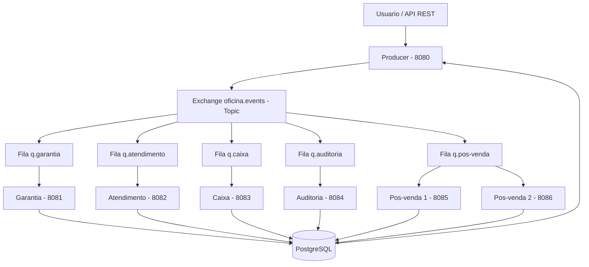

# Oficina de Bicicletas — RabbitMQ

Sistema distribuído orientado a eventos para gerenciamento de operações de uma oficina de bicicletas, utilizando Java, Spring Boot, RabbitMQ, PostgreSQL e Docker.

---

## 1. Identificação do trabalho

- **Instituição:** Centro Universitário de Ourinhos — UNIFIO
- **Curso:** Engenharia de Software
- **Disciplina:** Sistemas Distribuídos e Cloud Computing
- **Grupo:** Vortek
- **Tema:** Oficina de Bicicletas — Comunicação Orientada a Eventos com RabbitMQ

### Integrantes

| Nome | RA |
|---|---|
| Caio Argenta | 269560 |
| João Pedro Padoveze | 269532 |
| Elias Marques | 269119 |

---

## 2. Objetivo

O projeto demonstra a implementação de um sistema distribuído baseado em mensageria assíncrona, utilizando RabbitMQ como intermediário de comunicação entre produtores e consumidores.

A aplicação simula eventos relacionados às operações de uma oficina de bicicletas, permitindo que diferentes módulos executem suas responsabilidades de maneira independente.

O sistema contempla:

- Publicação de eventos;
- Comunicação assíncrona;
- Roteamento por routing keys;
- Exchange do tipo Topic;
- Consumidores independentes;
- Persistência em PostgreSQL;
- Confirmação manual de mensagens (ACK);
- Tratamento de falhas (NACK);
- Idempotência;
- Competing Consumers;
- Recuperação após interrupção de consumidores;
- Configuração de credenciais por variáveis de ambiente.

---

## 3. Tecnologias utilizadas

| Tecnologia | Finalidade |
|---|---|
| Java 17 ou superior | Linguagem de programação |
| Spring Boot 3.4.2 | Desenvolvimento da aplicação |
| Spring AMQP | Integração com RabbitMQ |
| RabbitMQ 3.13 | Broker de mensagens |
| PostgreSQL 16 | Persistência dos dados |
| Maven | Compilação e gerenciamento de dependências |
| Docker | Execução da infraestrutura |
| Docker Compose | Orquestração dos containers |
| Git e GitHub | Versionamento do código |
| REST API | Publicação e consulta dos eventos |

---

## 4. Pré-requisitos

Antes de executar o projeto, é necessário possuir:

- Java JDK 17 ou superior;
- Apache Maven;
- Docker Desktop;
- Docker Compose;
- Git;
- Prompt de Comando do Windows (CMD).

Os comandos deste README foram preparados e testados no Windows CMD.

Verifique as instalações:

```cmd
java -version
```

```cmd
mvn -version
```

```cmd
docker --version
```

```cmd
docker compose version
```

```cmd
git --version
```

Certifique-se de que o Docker Desktop esteja aberto antes de continuar.

---

## 5. Arquitetura do sistema

O sistema possui um produtor de eventos e cinco responsabilidades consumidoras.

O módulo de Pós-venda pode ser executado em múltiplas instâncias, permitindo demonstrar o padrão Competing Consumers.



### Fluxo de processamento

1. O usuário envia uma requisição HTTP ao Producer.
2. O Producer cria um evento no formato JSON.
3. O evento é publicado na exchange `oficina.events`.
4. O RabbitMQ identifica as filas compatíveis com a routing key.
5. Os consumidores recebem as mensagens.
6. Cada consumidor executa sua responsabilidade.
7. Os resultados são persistidos no PostgreSQL.
8. A mensagem é confirmada após o processamento bem-sucedido.
9. Os resultados podem ser consultados pela API REST.

---

## 6. Responsabilidades dos consumidores

### Garantia

Responsável por registrar a garantia de uma ordem de serviço concluída.

Informações registradas:

- Identificador da ordem de serviço;
- Identificador do evento;
- Nome do cliente;
- Data de início;
- Data de término;
- Prazo da garantia.

### Atendimento

Responsável por registrar mensagens relacionadas ao atendimento do cliente.

Processa:

- Ordem de serviço concluída;
- Ordem de serviço cancelada;
- Pagamento estornado.

### Caixa

Responsável pelo registro das movimentações financeiras.

Processa:

- Pagamento recebido;
- Pagamento estornado.

### Auditoria

Responsável por registrar todos os eventos publicados na exchange.

Armazena:

- Identificador do evento;
- Tipo do evento;
- Ordem de serviço;
- Payload original;
- Data de ocorrência;
- Data de recebimento.

### Pós-venda

Responsável por registrar o acompanhamento do cliente após a conclusão de uma ordem de serviço.

Pode ser executado em duas ou mais instâncias conectadas à mesma fila.

Cada registro identifica a instância responsável pelo processamento.

---

## 7. Configuração do ambiente

Abra o CMD na pasta raiz do projeto.

Caso esteja utilizando o ambiente de desenvolvimento original:

```cmd
cd /d T:\Projetos\oficina-bicicletas-rabbitmq
```

Em outro computador, utilize o caminho correspondente à pasta do projeto.

### 7.1. Criar o arquivo de configuração

O repositório disponibiliza o arquivo `.env.example` como modelo.

Execute:

```cmd
copy .env.example .env
```

Caso o arquivo `.env` já exista, não é necessário sobrescrevê-lo.

Abra o arquivo:

```cmd
notepad .env
```

Configure as variáveis:

```dotenv
DB_NAME=oficina
DB_USER=oficina
DB_PASSWORD=DEFINA_SUA_SENHA
DB_HOST=127.0.0.1
DB_PORT=5433

RABBIT_HOST=127.0.0.1
RABBIT_PORT=5673
RABBIT_USER=oficina
RABBIT_PASSWORD=DEFINA_SUA_SENHA
RABBIT_MANAGEMENT_PORT=15672
```

Substitua `DEFINA_SUA_SENHA` pelas senhas desejadas para o ambiente local.

Para facilitar a execução pelo CMD, recomenda-se utilizar senhas de demonstração sem caracteres especiais interpretados pelo terminal.

As credenciais devem permanecer exclusivamente no arquivo `.env`, que não deve ser enviado ao GitHub.

### 7.2. Carregar as variáveis no CMD

O Docker Compose utiliza automaticamente o arquivo `.env`.

Entretanto, os processos Java iniciados diretamente pelo CMD precisam receber as variáveis de ambiente.

Execute:

```cmd
for /f "usebackq eol=# tokens=1,* delims==" %A in (".env") do @set "%A=%B"
```

Configure a URL de conexão:

```cmd
set "DB_URL=jdbc:postgresql://%DB_HOST%:%DB_PORT%/%DB_NAME%"
```

Esses comandos devem ser executados novamente sempre que um novo CMD for utilizado para iniciar as aplicações.

### 7.3. Validar a configuração

```cmd
docker compose config --quiet
```

Caso não sejam apresentados erros, a configuração do Docker Compose é válida.

---

## 8. Iniciar a infraestrutura

Execute:

```cmd
docker compose up -d
```

Aguarde a inicialização:

```cmd
timeout /t 15 /nobreak
```

Confira os containers:

```cmd
docker compose ps
```

### 8.1. Verificar o PostgreSQL

```cmd
docker compose exec postgres pg_isready -U %DB_USER% -d %DB_NAME%
```

Resultado esperado:

```text
accepting connections
```

Para validar a autenticação:

```cmd
docker compose exec -e PGPASSWORD="%DB_PASSWORD%" postgres psql -h 127.0.0.1 -U %DB_USER% -d %DB_NAME% -c "SELECT current_database(), current_user;"
```

### 8.2. Verificar o RabbitMQ

```cmd
docker compose exec rabbitmq rabbitmq-diagnostics -q ping
```

Resultado esperado:

```text
Ping succeeded
```

### 8.3. Portas utilizadas

| Serviço | Porta externa | Porta interna |
|---|---:|---:|
| PostgreSQL | 5433 | 5432 |
| RabbitMQ AMQP | 5673 | 5672 |
| RabbitMQ Management | 15672 | 15672 |

As portas externas 5433 e 5673 foram escolhidas para evitar conflitos com instalações locais.

### 8.4. Painel administrativo do RabbitMQ

Acesse:

http://localhost:15672

Credenciais:

- Usuário: valor de `RABBIT_USER` no arquivo `.env`;
- Senha: valor de `RABBIT_PASSWORD` no arquivo `.env`.

O painel permite visualizar:

- Exchanges;
- Filas;
- Bindings;
- Routing keys;
- Consumidores conectados;
- Mensagens pendentes;
- Mensagens aguardando confirmação;
- Taxas de publicação e consumo.

---

## 9. Importação das definições do RabbitMQ

O projeto disponibiliza o arquivo:

```text
definitions.json
```

Esse arquivo contém as definições da infraestrutura de mensageria utilizadas no projeto.

A importação deve ser realizada após iniciar o RabbitMQ e antes de iniciar as aplicações Java.

### 9.1. Copiar o arquivo para o container

```cmd
docker compose cp ./definitions.json rabbitmq:/tmp/definitions.json
```

### 9.2. Importar as definições

```cmd
docker compose exec rabbitmq rabbitmqctl import_definitions /tmp/definitions.json
```

A importação pode ocorrer de maneira assíncrona.

Aguarde alguns segundos:

```cmd
timeout /t 5 /nobreak
```

### 9.3. Conferir as exchanges

```cmd
docker compose exec rabbitmq rabbitmqctl list_exchanges name type
```

A exchange principal deverá estar presente:

```text
oficina.events    topic
```

### 9.4. Conferir as filas

```cmd
docker compose exec rabbitmq rabbitmqctl list_queues name durable
```

Filas esperadas:

```text
q.garantia
q.atendimento
q.caixa
q.auditoria
q.pos-venda
```

### 9.5. Conferir os bindings

```cmd
docker compose exec rabbitmq rabbitmqctl list_bindings source_name destination_name routing_key
```

As filas devem possuir os bindings apresentados na matriz de roteamento deste README.

As aplicações também declaram a infraestrutura de mensageria durante sua inicialização. Por isso, a conferência da importação deve ser realizada antes de iniciar os processos Java.

### 9.6. Exportar novamente as definições

Caso seja necessário atualizar o arquivo de definições:

```cmd
docker compose exec rabbitmq rabbitmqctl export_definitions /tmp/definitions.json
```

```cmd
docker compose cp rabbitmq:/tmp/definitions.json ./definitions.json
```

Antes de versionar o arquivo exportado, remova informações relacionadas à autenticação e permissões de usuários:

```cmd
powershell -NoProfile -Command "$d = Get-Content 'definitions.json' -Raw | ConvertFrom-Json; $d.PSObject.Properties.Remove('users'); $d.PSObject.Properties.Remove('permissions'); $d.PSObject.Properties.Remove('topic_permissions'); [System.IO.File]::WriteAllText((Join-Path (Get-Location) 'definitions.json'), ($d | ConvertTo-Json -Depth 100), (New-Object System.Text.UTF8Encoding($false)))"
```

Confira as propriedades restantes:

```cmd
powershell -NoProfile -Command "$d = Get-Content 'definitions.json' -Raw | ConvertFrom-Json; $d.PSObject.Properties.Name"
```

Revise também o conteúdo completo para garantir que não existam senhas, hashes de autenticação ou outros segredos.

Os usuários e suas permissões são configurados no ambiente de demonstração por meio do Docker Compose.

---

## 10. Compilar o projeto

Antes de recompilar, encerre todas as aplicações Java anteriormente iniciadas.

No Windows, processos Java ativos podem manter o arquivo JAR bloqueado, impedindo que o Maven exclua a pasta `target`.

Execute:

```cmd
mvn clean package
```

Resultado esperado:

```text
BUILD SUCCESS
```

O arquivo gerado será:

```text
target/oficina-bicicletas-1.0.0.jar
```

Os testes apresentados neste README são testes funcionais manuais e de integração. A compilação Maven não representa a execução de uma suíte automatizada de testes unitários.

---

## 11. Iniciar as aplicações

Certifique-se de que as variáveis do arquivo `.env` foram carregadas no CMD.

O mesmo arquivo JAR é utilizado para executar todos os módulos.

A responsabilidade de cada processo é definida pelo parâmetro `app.role`.

### 11.1. Iniciar todos os serviços de uma vez

Copie e execute o comando completo:

```cmd
start "Producer" cmd /k "java -jar target/oficina-bicicletas-1.0.0.jar --app.role=producer --server.port=8080" && start "Garantia" cmd /k "java -jar target/oficina-bicicletas-1.0.0.jar --app.role=garantia --server.port=8081" && start "Atendimento" cmd /k "java -jar target/oficina-bicicletas-1.0.0.jar --app.role=atendimento --server.port=8082" && start "Caixa" cmd /k "java -jar target/oficina-bicicletas-1.0.0.jar --app.role=caixa --server.port=8083" && start "Auditoria" cmd /k "java -jar target/oficina-bicicletas-1.0.0.jar --app.role=auditoria --server.port=8084" && start "Pos-venda 1" cmd /k "set INSTANCE_ID=posvenda-1&& java -jar target/oficina-bicicletas-1.0.0.jar --app.role=posvenda --server.port=8085" && start "Pos-venda 2" cmd /k "set INSTANCE_ID=posvenda-2&& java -jar target/oficina-bicicletas-1.0.0.jar --app.role=posvenda --server.port=8086"
```

Serão abertas sete janelas independentes.

Não feche essas janelas durante os testes.

### 11.2. Inicialização individual

Caso seja necessário iniciar apenas um serviço, utilize o comando correspondente.

#### Producer

```cmd
start "Producer" cmd /k "java -jar target/oficina-bicicletas-1.0.0.jar --app.role=producer --server.port=8080"
```

#### Garantia

```cmd
start "Garantia" cmd /k "java -jar target/oficina-bicicletas-1.0.0.jar --app.role=garantia --server.port=8081"
```

#### Atendimento

```cmd
start "Atendimento" cmd /k "java -jar target/oficina-bicicletas-1.0.0.jar --app.role=atendimento --server.port=8082"
```

#### Caixa

```cmd
start "Caixa" cmd /k "java -jar target/oficina-bicicletas-1.0.0.jar --app.role=caixa --server.port=8083"
```

#### Auditoria

```cmd
start "Auditoria" cmd /k "java -jar target/oficina-bicicletas-1.0.0.jar --app.role=auditoria --server.port=8084"
```

#### Pós-venda — Instância 1

```cmd
start "Pos-venda 1" cmd /k "set INSTANCE_ID=posvenda-1&& java -jar target/oficina-bicicletas-1.0.0.jar --app.role=posvenda --server.port=8085"
```

#### Pós-venda — Instância 2

```cmd
start "Pos-venda 2" cmd /k "set INSTANCE_ID=posvenda-2&& java -jar target/oficina-bicicletas-1.0.0.jar --app.role=posvenda --server.port=8086"
```

### 11.3. Portas das aplicações

| Aplicação | Porta |
|---|---:|
| Producer | 8080 |
| Garantia | 8081 |
| Atendimento | 8082 |
| Caixa | 8083 |
| Auditoria | 8084 |
| Pós-venda 1 | 8085 |
| Pós-venda 2 | 8086 |

---

## 12. Validar a inicialização

Aguarde a inicialização dos processos e confira as portas:

```cmd
timeout /t 20 /nobreak && netstat -ano | findstr LISTENING | findstr /R /C:":808[0-6] "
```

Todas as portas entre 8080 e 8086 deverão estar disponíveis.

Caso alguma porta não apareça, verifique os logs da janela correspondente.

### 12.1. Conferir os consumidores

```cmd
docker compose exec rabbitmq rabbitmqctl list_queues name messages_ready messages_unacknowledged consumers
```

Resultado esperado em um ambiente limpo:

| Fila | Ready | Unacked | Consumidores |
|---|---:|---:|---:|
| q.garantia | 0 | 0 | 1 |
| q.atendimento | 0 | 0 | 1 |
| q.caixa | 0 | 0 | 1 |
| q.auditoria | 0 | 0 | 1 |
| q.pos-venda | 0 | 0 | 2 |

Total de consumidores conectados: 6.

### 12.2. Conferir a API e o banco

```cmd
curl -f http://localhost:8080/api/consultas/garantias && curl -f http://localhost:8080/api/consultas/atendimento && curl -f http://localhost:8080/api/consultas/caixa && curl -f http://localhost:8080/api/consultas/auditoria && curl -f http://localhost:8080/api/consultas/pos-venda
```

Em um ambiente sem registros, o resultado esperado é:

```text
[][][][][]
```

Caso existam registros de execuções anteriores, serão apresentados os dados já armazenados.

---

## 13. Eventos e roteamento

O sistema utiliza a exchange:

```text
oficina.events
```

Tipo:

```text
topic
```

### 13.1. Eventos disponíveis

| Evento | Routing key |
|---|---|
| ORDEM_SERVICO_CONCLUIDA | os.concluida |
| ORDEM_SERVICO_CANCELADA | os.cancelada |
| PAGAMENTO_RECEBIDO | financeiro.recebido |
| PAGAMENTO_ESTORNADO | financeiro.estornado |

### 13.2. Matriz evento × consumidor

| Evento | Garantia | Atendimento | Caixa | Auditoria | Pós-venda |
|---|---|---|---|---|---|
| OS concluída | Sim | Sim | Não | Sim | Sim |
| OS cancelada | Não | Sim | Não | Sim | Não |
| Pagamento recebido | Não | Não | Sim | Sim | Não |
| Pagamento estornado | Não | Sim | Sim | Sim | Não |

### 13.3. Bindings

| Fila | Binding key |
|---|---|
| q.garantia | os.concluida |
| q.atendimento | os.concluida |
| q.atendimento | os.cancelada |
| q.atendimento | financeiro.estornado |
| q.caixa | financeiro.* |
| q.auditoria | # |
| q.pos-venda | os.concluida |

### 13.4. Wildcards

A exchange Topic permite utilizar curingas nas binding keys.

- `*` corresponde exatamente a uma palavra.
- `#` corresponde a zero ou mais palavras.

Exemplo:

```text
financeiro.*
```

Permite que o Caixa receba eventos como:

```text
financeiro.recebido
financeiro.estornado
```

O binding:

```text
#
```

Permite que a Auditoria receba todos os eventos publicados na exchange.

### 13.5. Justificativa da escolha

A exchange Topic foi escolhida por permitir o roteamento seletivo de eventos, combinando correspondências exatas com padrões de routing keys.

Essa abordagem facilita a evolução do sistema e a inclusão de novos consumidores sem exigir alterações diretas no Producer.

### 13.6. Comparação entre exchanges

| Exchange | Funcionamento | Aplicação neste projeto |
|---|---|---|
| Direct | Correspondência exata da routing key | Exigiria bindings individuais para cada evento |
| Fanout | Distribui mensagens para todas as filas vinculadas | Enviaria eventos para módulos que não precisam processá-los |
| Topic | Correspondência por padrões e curingas | Permite roteamento seletivo e flexível |

A exchange Topic atende melhor às necessidades da oficina porque diferentes consumidores possuem interesses distintos nos eventos publicados.

---

## 14. Contrato JSON dos eventos

Os eventos utilizam uma estrutura JSON padronizada.

Exemplo:

```json
{
  "eventId": "evt-os-001",
  "tipo": "ORDEM_SERVICO_CONCLUIDA",
  "ocorridoEm": "2026-11-26T02:24:37Z",
  "ordemId": "OS-001",
  "clienteNome": "Joao Silva",
  "prazoGarantiaDias": 90,
  "valor": null,
  "referencia": null
}
```

### Descrição dos campos

| Campo | Descrição |
|---|---|
| eventId | Identificador único do evento |
| tipo | Tipo do evento publicado |
| ocorridoEm | Data e hora de ocorrência |
| ordemId | Identificador da ordem de serviço |
| clienteNome | Nome do cliente |
| prazoGarantiaDias | Prazo da garantia |
| valor | Valor da movimentação financeira |
| referencia | Referência da operação financeira |

O `eventId` é utilizado no controle de idempotência.

Quando não informado na requisição, o sistema gera um identificador para o evento.

Os campos que não se aplicam a determinado tipo de evento podem possuir valor nulo.

---

## 15. Teste 1 — Publicação e roteamento

Os comandos seguintes utilizam identificadores fixos para facilitar a reprodução dos testes.

Em execuções repetidas, os eventos com os mesmos identificadores não devem gerar efeitos duplicados.

### 15.1. Ordem de serviço concluída

```cmd
curl -f -X POST http://localhost:8080/api/eventos/os-concluida -H "Content-Type: application/json" -d "{\"eventId\":\"evt-os-001\",\"ordemId\":\"OS-001\",\"clienteNome\":\"Joao Silva\",\"prazoGarantiaDias\":90}"
```

Consumidores esperados:

- Garantia;
- Atendimento;
- Auditoria;
- Pós-venda.

### 15.2. Ordem de serviço cancelada

```cmd
curl -f -X POST http://localhost:8080/api/eventos/os-cancelada -H "Content-Type: application/json" -d "{\"eventId\":\"evt-os-002\",\"ordemId\":\"OS-002\",\"clienteNome\":\"Maria Souza\"}"
```

Consumidores esperados:

- Atendimento;
- Auditoria.

### 15.3. Pagamento recebido

```cmd
curl -f -X POST http://localhost:8080/api/eventos/pagamento-recebido -H "Content-Type: application/json" -d "{\"eventId\":\"evt-fin-001\",\"ordemId\":\"OS-001\",\"clienteNome\":\"Joao Silva\",\"valor\":250.00,\"referencia\":\"PIX-001\"}"
```

Consumidores esperados:

- Caixa;
- Auditoria.

### 15.4. Pagamento estornado

```cmd
curl -f -X POST http://localhost:8080/api/eventos/pagamento-estornado -H "Content-Type: application/json" -d "{\"eventId\":\"evt-fin-002\",\"ordemId\":\"OS-001\",\"clienteNome\":\"Joao Silva\",\"valor\":250.00,\"referencia\":\"PIX-001\"}"
```

Consumidores esperados:

- Atendimento;
- Caixa;
- Auditoria.

### 15.5. Publicar os quatro eventos de uma vez

Como alternativa aos comandos individuais, execute:

```cmd
curl -f -X POST http://localhost:8080/api/eventos/os-concluida -H "Content-Type: application/json" -d "{\"eventId\":\"evt-os-001\",\"ordemId\":\"OS-001\",\"clienteNome\":\"Joao Silva\",\"prazoGarantiaDias\":90}" && curl -f -X POST http://localhost:8080/api/eventos/os-cancelada -H "Content-Type: application/json" -d "{\"eventId\":\"evt-os-002\",\"ordemId\":\"OS-002\",\"clienteNome\":\"Maria Souza\"}" && curl -f -X POST http://localhost:8080/api/eventos/pagamento-recebido -H "Content-Type: application/json" -d "{\"eventId\":\"evt-fin-001\",\"ordemId\":\"OS-001\",\"clienteNome\":\"Joao Silva\",\"valor\":250.00,\"referencia\":\"PIX-001\"}" && curl -f -X POST http://localhost:8080/api/eventos/pagamento-estornado -H "Content-Type: application/json" -d "{\"eventId\":\"evt-fin-002\",\"ordemId\":\"OS-001\",\"clienteNome\":\"Joao Silva\",\"valor\":250.00,\"referencia\":\"PIX-001\"}"
```

### 15.6. Consultar os resultados

```cmd
timeout /t 5 /nobreak && curl -f http://localhost:8080/api/consultas/garantias && curl -f http://localhost:8080/api/consultas/atendimento && curl -f http://localhost:8080/api/consultas/caixa && curl -f http://localhost:8080/api/consultas/auditoria && curl -f http://localhost:8080/api/consultas/pos-venda
```

### 15.7. Resultado esperado e validado

Considerando um banco inicialmente vazio:

| Consumidor | Registros esperados | Registros obtidos |
|---|---:|---:|
| Garantia | 1 | 1 |
| Atendimento | 3 | 3 |
| Caixa | 2 | 2 |
| Auditoria | 4 | 4 |
| Pós-venda | 1 | 1 |
| **Total** | **11** | **11** |

Resultado: aprovado.

---

## 16. Teste 2 — Competing Consumers

O padrão Competing Consumers permite que múltiplas instâncias consumam mensagens de uma mesma fila.

Neste projeto, duas instâncias do módulo Pós-venda estão conectadas à fila:

```text
q.pos-venda
```

Cada mensagem é entregue a uma instância por vez, podendo ser reentregue em caso de falha.

### 16.1. Conferir as duas instâncias

```cmd
docker compose exec rabbitmq rabbitmqctl list_queues name messages_ready messages_unacknowledged consumers
```

Resultado esperado para a fila:

```text
q.pos-venda    0    0    2
```

### 16.2. Publicar quatro eventos adicionais

```cmd
curl -f -X POST http://localhost:8080/api/eventos/os-concluida -H "Content-Type: application/json" -d "{\"eventId\":\"evt-comp-001\",\"ordemId\":\"OS-101\",\"clienteNome\":\"Cliente 1\",\"prazoGarantiaDias\":90}" && curl -f -X POST http://localhost:8080/api/eventos/os-concluida -H "Content-Type: application/json" -d "{\"eventId\":\"evt-comp-002\",\"ordemId\":\"OS-102\",\"clienteNome\":\"Cliente 2\",\"prazoGarantiaDias\":90}" && curl -f -X POST http://localhost:8080/api/eventos/os-concluida -H "Content-Type: application/json" -d "{\"eventId\":\"evt-comp-003\",\"ordemId\":\"OS-103\",\"clienteNome\":\"Cliente 3\",\"prazoGarantiaDias\":90}" && curl -f -X POST http://localhost:8080/api/eventos/os-concluida -H "Content-Type: application/json" -d "{\"eventId\":\"evt-comp-004\",\"ordemId\":\"OS-104\",\"clienteNome\":\"Cliente 4\",\"prazoGarantiaDias\":90}" && timeout /t 5 /nobreak && curl -f http://localhost:8080/api/consultas/pos-venda
```

### 16.3. Resultado obtido

Durante a validação realizada em 25/11/2026, os quatro eventos adicionais foram distribuídos da seguinte maneira:

| Evento | Instância responsável |
|---|---|
| evt-comp-001 | posvenda-2 |
| evt-comp-002 | posvenda-1 |
| evt-comp-003 | posvenda-2 |
| evt-comp-004 | posvenda-1 |

Distribuição observada:

- Pós-venda 1: 2 eventos;
- Pós-venda 2: 2 eventos;
- Total: 4 eventos;
- Efeitos duplicados: 0.

A distribuição não precisa ser necessariamente igual em todas as execuções.

O objetivo é demonstrar que as instâncias compartilham a mesma fila e que cada evento produz apenas o efeito esperado.

Resultado: aprovado.

---

## 17. Teste 3 — Interrupção e recuperação

Este teste demonstra que uma mensagem pode permanecer armazenada no RabbitMQ enquanto seu consumidor está indisponível.

### 17.1. Interromper o Atendimento

Localize a janela do Atendimento e pressione:

```text
Ctrl + C
```

Alternativamente, identifique o PID do processo:

```cmd
netstat -ano | findstr LISTENING | findstr :8082
```

Encerre somente o processo correspondente, substituindo PID pelo número apresentado:

```cmd
taskkill /PID PID /F
```

Confirme que a porta 8082 não está mais em execução:

```cmd
netstat -ano | findstr LISTENING | findstr :8082
```

Confira também se a fila está sem consumidores:

```cmd
docker compose exec rabbitmq rabbitmqctl list_queues name messages_ready messages_unacknowledged consumers
```

Antes de publicar o evento, o resultado esperado para a fila é:

```text
q.atendimento    0    0    0
```

### 17.2. Publicar um evento durante a interrupção

```cmd
curl -f -X POST http://localhost:8080/api/eventos/os-cancelada -H "Content-Type: application/json" -d "{\"eventId\":\"evt-off-001\",\"ordemId\":\"OS-201\",\"clienteNome\":\"Teste Recuperacao\"}" && timeout /t 5 /nobreak && docker compose exec rabbitmq rabbitmqctl list_queues name messages_ready messages_unacknowledged consumers
```

Resultado esperado:

```text
q.atendimento    1    0    0
```

A mensagem permanece disponível na fila, aguardando o retorno do consumidor.

A Auditoria continua funcionando normalmente, pois possui sua própria fila.

### 17.3. Consultar antes da recuperação

```cmd
curl -f http://localhost:8080/api/consultas/auditoria && curl -f http://localhost:8080/api/consultas/atendimento
```

O evento `evt-off-001` deverá aparecer na Auditoria, mas ainda não deverá estar registrado no Atendimento.

### 17.4. Reiniciar o Atendimento

```cmd
start "Atendimento" cmd /k "java -jar target/oficina-bicicletas-1.0.0.jar --app.role=atendimento --server.port=8082"
```

### 17.5. Confirmar a recuperação

```cmd
timeout /t 15 /nobreak && curl -f http://localhost:8080/api/consultas/atendimento && docker compose exec rabbitmq rabbitmqctl list_queues name messages_ready messages_unacknowledged consumers
```

O evento deverá aparecer no Atendimento.

Resultado esperado da fila:

```text
q.atendimento    0    0    1
```

A recuperação foi observada em testes anteriores, nos quais o Atendimento processou eventos após sua reinicialização.

Para uma demonstração completa, é necessário confirmar que o consumidor realmente foi interrompido antes da publicação.

Caso o teste seja repetido sem limpar o banco, utilize um novo `eventId` e uma nova ordem de serviço.

---

## 18. Teste 4 — Idempotência

A idempotência garante que o recebimento repetido de um evento não produza efeitos duplicados no sistema.

O controle utiliza o identificador `eventId` e restrições de unicidade no PostgreSQL.

### 18.1. Publicar duas vezes o mesmo evento

```cmd
curl -f -X POST http://localhost:8080/api/eventos/os-concluida -H "Content-Type: application/json" -d "{\"eventId\":\"evt-dup-001\",\"ordemId\":\"OS-301\",\"clienteNome\":\"Teste Duplicidade\",\"prazoGarantiaDias\":90}" && timeout /t 3 /nobreak && curl -f -X POST http://localhost:8080/api/eventos/os-concluida -H "Content-Type: application/json" -d "{\"eventId\":\"evt-dup-001\",\"ordemId\":\"OS-301\",\"clienteNome\":\"Teste Duplicidade\",\"prazoGarantiaDias\":90}"
```

### 18.2. Consultar os módulos envolvidos

```cmd
timeout /t 5 /nobreak && curl -f http://localhost:8080/api/consultas/garantias && curl -f http://localhost:8080/api/consultas/atendimento && curl -f http://localhost:8080/api/consultas/auditoria && curl -f http://localhost:8080/api/consultas/pos-venda
```

### 18.3. Resultado esperado e obtido

| Consumidor | Publicações | Registros do evento |
|---|---:|---:|
| Garantia | 2 | 1 |
| Atendimento | 2 | 1 |
| Auditoria | 2 | 1 |
| Pós-venda | 2 | 1 |

O evento foi publicado duas vezes com o mesmo identificador.

Entretanto, cada módulo envolvido apresentou apenas um registro correspondente ao evento.

Resultado: aprovado.

---

## 19. Confirmação de mensagens — ACK e NACK

O sistema utiliza confirmação manual de mensagens.

Configuração:

```yaml
spring:
  rabbitmq:
    listener:
      simple:
        acknowledge-mode: manual
```

### ACK — Acknowledgement

O ACK informa ao RabbitMQ que a mensagem foi processada com sucesso.

O fluxo de processamento considera:

1. Recebimento da mensagem;
2. Interpretação do JSON;
3. Execução da responsabilidade do consumidor;
4. Persistência do resultado;
5. Confirmação da mensagem.

A confirmação ocorre após a conclusão bem-sucedida do processamento.

### NACK — Negative Acknowledgement

Quando ocorre uma falha no processamento, a mensagem pode receber uma confirmação negativa.

Com a opção de requeue, o RabbitMQ disponibiliza novamente a mensagem para processamento.

Isso permite novas tentativas em situações de falha.

### Relação entre ACK e idempotência

Caso um consumidor grave o resultado no banco, mas seja interrompido antes de confirmar a mensagem, o RabbitMQ poderá realizar uma nova entrega.

O controle de idempotência evita que essa nova entrega produza registros duplicados.

A combinação dessas estratégias permite trabalhar com entrega do tipo at-least-once, sem depender de uma garantia de entrega exatamente uma vez pelo broker.

---

## 20. Endpoints da API

### Publicação de eventos

| Método | Endpoint |
|---|---|
| POST | /api/eventos/os-concluida |
| POST | /api/eventos/os-cancelada |
| POST | /api/eventos/pagamento-recebido |
| POST | /api/eventos/pagamento-estornado |

### Consultas

| Método | Endpoint |
|---|---|
| GET | /api/consultas/garantias |
| GET | /api/consultas/atendimento |
| GET | /api/consultas/caixa |
| GET | /api/consultas/auditoria |
| GET | /api/consultas/pos-venda |

### Links de acesso direto

Com o Producer em execução, os resultados podem ser consultados pelo navegador.

- [Garantias](http://localhost:8080/api/consultas/garantias)
- [Atendimento](http://localhost:8080/api/consultas/atendimento)
- [Caixa](http://localhost:8080/api/consultas/caixa)
- [Auditoria](http://localhost:8080/api/consultas/auditoria)
- [Pós-venda](http://localhost:8080/api/consultas/pos-venda)
- [Painel RabbitMQ](http://localhost:15672)

Os endpoints de consulta retornam os dados no formato JSON.

---

## 21. Validação final dos testes

Após executar os quatro cenários de teste, consulte todos os módulos:

```cmd
timeout /t 5 /nobreak && curl -f http://localhost:8080/api/consultas/garantias && curl -f http://localhost:8080/api/consultas/atendimento && curl -f http://localhost:8080/api/consultas/caixa && curl -f http://localhost:8080/api/consultas/auditoria && curl -f http://localhost:8080/api/consultas/pos-venda && docker compose exec rabbitmq rabbitmqctl list_queues name messages_ready messages_unacknowledged consumers
```

### 21.1. Resultado registrado em 25/11/2026

A execução foi realizada a partir de um banco inicialmente vazio.

| Consumidor | Esperado | Obtido |
|---|---:|---:|
| Garantia | 6 | 6 |
| Atendimento | 9 | 9 |
| Caixa | 2 | 2 |
| Auditoria | 10 | 10 |
| Pós-venda | 6 | 6 |
| **Total** | **33** | **33** |

Foram publicados dez eventos únicos, além da repetição intencional de um evento para testar a idempotência.

Os resultados totalizaram 33 registros distribuídos entre os cinco módulos consumidores.

### 21.2. Estado final do RabbitMQ

| Fila | Ready | Unacked | Consumidores |
|---|---:|---:|---:|
| q.garantia | 0 | 0 | 1 |
| q.atendimento | 0 | 0 | 1 |
| q.caixa | 0 | 0 | 1 |
| q.auditoria | 0 | 0 | 1 |
| q.pos-venda | 0 | 0 | 2 |
| **Total** | **0** | **0** | **6** |

Nenhuma mensagem permaneceu pendente ou aguardando confirmação ao final da execução.

### 21.3. Resumo da validação

| Teste | Resultado |
|---|---|
| Compilação Maven | Aprovado |
| Inicialização dos sete serviços | Aprovado |
| Conexão com PostgreSQL | Aprovado |
| Conexão com RabbitMQ | Aprovado |
| Publicação dos quatro tipos de eventos | Aprovado |
| Roteamento seletivo | Aprovado |
| Persistência dos registros | Aprovado |
| Competing Consumers | Aprovado |
| Idempotência | Aprovado |
| Execução com variáveis de ambiente | Validada na inicialização |
| Recuperação de consumidor | Observada em testes anteriores |
| Conferência dos 33 registros | Aprovado |
| Esvaziamento das filas | Aprovado |

Na última execução consolidada, o Atendimento permaneceu conectado durante a publicação do evento de recuperação. Portanto, a contagem de 33 registros comprova o processamento dos eventos, mas não comprova isoladamente a interrupção do consumidor.

O procedimento da seção 17 permite reproduzir corretamente esse cenário.

---

## 22. Estrutura do projeto

```text
oficina-bicicletas-rabbitmq/
|
|-- .env.example
|-- .gitignore
|-- definitions.json
|-- docker-compose.yml
|-- pom.xml
|-- README.md
|
|-- docs/
|
|-- src/
|   |-- main/
|       |-- java/
|       |-- resources/
|           |-- application.yml
|           |-- schema.sql
|
|-- target/
```

Descrição:

| Arquivo ou pasta | Finalidade |
|---|---|
| .env.example | Modelo das variáveis de ambiente |
| .env | Credenciais locais, não versionadas |
| .gitignore | Exclusão de arquivos locais e sensíveis |
| definitions.json | Definições do RabbitMQ |
| docker-compose.yml | Infraestrutura do ambiente |
| pom.xml | Dependências e configuração Maven |
| README.md | Documentação e instruções de execução |
| docs/ | Documentação complementar |
| src/ | Código-fonte |
| application.yml | Configurações da aplicação |
| schema.sql | Estrutura inicial do banco |
| target/ | Arquivos gerados durante a compilação |

---

## 23. Segurança das credenciais

As credenciais do PostgreSQL e RabbitMQ devem ser mantidas fora do código-fonte.

O arquivo `application.yml` utiliza variáveis de ambiente:

```yaml
server:
  port: ${SERVER_PORT:8080}

spring:
  datasource:
    url: ${DB_URL:jdbc:postgresql://127.0.0.1:5433/oficina}
    username: ${DB_USER}
    password: ${DB_PASSWORD}

  sql:
    init:
      mode: always

  rabbitmq:
    host: ${RABBIT_HOST:127.0.0.1}
    port: ${RABBIT_PORT:5673}
    username: ${RABBIT_USER}
    password: ${RABBIT_PASSWORD}

    listener:
      simple:
        acknowledge-mode: manual

app:
  role: ${APP_ROLE:producer}
```

O Docker Compose também utiliza variáveis externas:

```yaml
services:
  rabbitmq:
    image: rabbitmq:3.13-management
    ports:
      - "${RABBIT_PORT:-5673}:5672"
      - "${RABBIT_MANAGEMENT_PORT:-15672}:15672"
    environment:
      RABBITMQ_DEFAULT_USER: ${RABBIT_USER}
      RABBITMQ_DEFAULT_PASS: ${RABBIT_PASSWORD}

  postgres:
    image: postgres:16
    ports:
      - "${DB_PORT:-5433}:5432"
    environment:
      POSTGRES_DB: ${DB_NAME}
      POSTGRES_USER: ${DB_USER}
      POSTGRES_PASSWORD: ${DB_PASSWORD}
    volumes:
      - postgres_data:/var/lib/postgresql/data

volumes:
  postgres_data:
```

O arquivo `.gitignore` deve conter:

```gitignore
# Credenciais
.env
.env.*
!.env.example

# Maven
target/
*.class

# IDEs
.idea/
.vscode/
*.iml

# Logs
*.log

# Sistema operacional
.DS_Store
Thumbs.db
```

Somente o arquivo `.env.example`, contendo valores de exemplo, deve ser versionado.

O arquivo `definitions.json` não deve conter credenciais, hashes de senhas ou informações sensíveis.

A aplicação foi desenvolvida para fins acadêmicos e demonstração local. A API não deve ser exposta publicamente sem mecanismos adicionais de autenticação, autorização e proteção de rede.

---

## 24. Encerrar o ambiente

Encerre as sete aplicações Java pressionando `Ctrl + C` nas respectivas janelas.

Para interromper os containers preservando os dados:

```cmd
docker compose stop
```

Para remover os containers e preservar o volume do PostgreSQL:

```cmd
docker compose down
```

Para iniciar novamente:

```cmd
docker compose up -d
```

---

## 25. Reiniciar completamente os testes

ATENÇÃO: o comando abaixo remove os volumes do ambiente Docker deste projeto e apaga os registros de demonstração armazenados.

Utilize somente quando desejar iniciar uma nova validação com o banco vazio.

Antes de executar, encerre todos os processos Java.

```cmd
docker compose down -v && docker compose up -d && timeout /t 15 /nobreak && docker compose ps
```

Depois:

1. Carregue as variáveis de ambiente.
2. Importe o arquivo `definitions.json`.
3. Confira as exchanges, filas e bindings.
4. Compile o projeto.
5. Inicie os sete serviços.
6. Confirme que as consultas retornam listas vazias.
7. Execute novamente os testes.

A remoção dos volumes não é necessária para o uso normal da aplicação.

---

## 26. Solução de problemas

### Erro de conexão com PostgreSQL

Verifique se o container está em execução:

```cmd
docker compose ps
```

Confirme a porta:

```cmd
docker compose port postgres 5432
```

A porta externa padrão do projeto é 5433.

Confira se as variáveis de ambiente foram carregadas no CMD.

Caso as credenciais tenham sido alteradas depois da criação do volume PostgreSQL, lembre-se de que as variáveis de inicialização não modificam automaticamente as senhas de um banco existente.

### Erro de conexão com RabbitMQ

Verifique:

```cmd
docker compose exec rabbitmq rabbitmq-diagnostics -q ping
```

Confira a porta:

```cmd
docker compose port rabbitmq 5672
```

A porta externa padrão é 5673.

### Erro ao executar mvn clean package

Caso o Maven não consiga excluir o arquivo JAR, encerre todas as aplicações Java.

Depois execute:

```cmd
mvn clean package
```

### Erro 405 — Method Not Allowed

Os endpoints de publicação utilizam POST.

Os endpoints de consulta utilizam GET.

Não cole dois comandos curl diretamente na mesma linha sem utilizar um separador como `&&`.

### Erro 500 — Internal Server Error

Verifique os logs do Producer e do módulo envolvido.

Confira:

- Conexão com PostgreSQL;
- Credenciais;
- Variáveis de ambiente;
- Inicialização das tabelas;
- Disponibilidade dos containers.

### Porta já utilizada

Confira os processos ativos:

```cmd
netstat -ano | findstr LISTENING | findstr /R /C:":808[0-6] "
```

Identifique o processo antes de encerrá-lo.

### Apenas um consumidor de Pós-venda

Confira a fila:

```cmd
docker compose exec rabbitmq rabbitmqctl list_queues name consumers
```

Caso exista somente um consumidor, verifique se a segunda instância foi iniciada corretamente.

```cmd
netstat -ano | findstr LISTENING | findstr :8086
```

Se a porta estiver livre, inicie a segunda instância:

```cmd
start "Pos-venda 2" cmd /k "set INSTANCE_ID=posvenda-2&& java -jar target/oficina-bicicletas-1.0.0.jar --app.role=posvenda --server.port=8086"
```

### Registros não aumentam ao repetir um teste

O sistema utiliza identificadores de eventos para evitar duplicidade.

Caso seja necessário gerar novos registros, utilize novos valores para `eventId` e `ordemId`, respeitando as regras de negócio.

---

## 27. Roteiro sugerido para demonstração

Durante a apresentação, recomenda-se seguir esta ordem:

1. Apresentar o tema e os integrantes.
2. Explicar a arquitetura distribuída.
3. Apresentar o RabbitMQ e a exchange Topic.
4. Demonstrar as cinco filas e seus bindings.
5. Apresentar os seis consumidores conectados.
6. Publicar os quatro tipos de eventos.
7. Consultar os resultados no PostgreSQL pela API.
8. Demonstrar Competing Consumers.
9. Interromper o Atendimento e confirmar a ausência de consumidores.
10. Publicar um evento e mostrar a mensagem pendente.
11. Reiniciar o Atendimento e confirmar a recuperação.
12. Publicar duas vezes o mesmo evento.
13. Demonstrar a idempotência.
14. Explicar ACK, NACK e persistência.
15. Apresentar o estado final das filas.

---

## 28. Possíveis melhorias futuras

Embora o projeto contemple os principais conceitos solicitados, algumas melhorias podem ser consideradas para utilização em ambientes de produção:

- Dead Letter Queue (DLQ);
- Política de tentativas limitadas;
- Retry com backoff;
- Transactional Outbox;
- Testes automatizados de integração;
- Autenticação e autorização da API;
- Comunicação criptografada;
- Monitoramento centralizado;
- Métricas e observabilidade;
- Escalabilidade horizontal;
- Alta disponibilidade do RabbitMQ;
- Interface gráfica para publicação e consulta de eventos.

Esses itens representam possibilidades de evolução e não são apresentados como funcionalidades já implementadas.

---

## 29. Conclusão

O projeto Oficina de Bicicletas demonstra a utilização de uma arquitetura distribuída orientada a eventos com RabbitMQ.

A exchange Topic permite distribuir mensagens de maneira seletiva entre os módulos, enquanto o PostgreSQL possibilita a persistência dos resultados e o controle de idempotência.

A execução de múltiplas instâncias de Pós-venda demonstra o compartilhamento de uma fila entre consumidores concorrentes.

A confirmação manual das mensagens, associada ao tratamento de falhas e à idempotência, contribui para a confiabilidade do processamento.

Os testes funcionais demonstraram a publicação dos quatro tipos de eventos, o roteamento entre os consumidores, a distribuição de mensagens entre instâncias e a prevenção de efeitos duplicados.

Na validação consolidada realizada em 25/11/2026, foram obtidos 33 registros, seis consumidores conectados e nenhuma mensagem pendente ao final do processamento.

O projeto disponibiliza uma infraestrutura reproduzível por Docker Compose, código-fonte Java, definições do RabbitMQ e documentação para execução e demonstração acadêmica.

---

**Grupo Vortek — Engenharia de Software — UNIFIO**

**Sistemas Distribuídos e Cloud Computing — 2026**